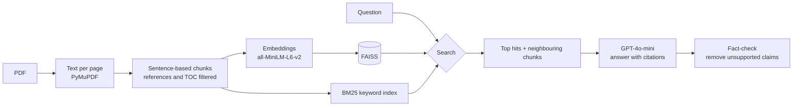

# ResearchCopilot

An AI research assistant for academic PDFs. Upload papers, ask questions in plain language, and get answers grounded in the documents, with the file and page behind every claim.

Built as a retrieval-augmented generation (RAG) pipeline with a search agent, a fact-checking step and a knowledge map, and evaluated with its own test sets to measure what each change actually does.

<!-- Add a screenshot or GIF of the app here:  -->

## Features

- Upload multiple PDFs and search across all of them
- Answers cite the source file and page for every claim
- Says clearly when the answer is not in the documents instead of guessing
- **Hybrid search**: combines meaning (embeddings) with exact words (BM25)
- **Scout**, a search agent that rephrases weak searches and stops when an answer isn't there
- **Fact-checking**: claims the sources don't support are removed before the answer is shown
- **Knowledge map**: every passage placed on a 2D map by meaning, so the paper's topics show up as islands
- **See the proof in the PDF**: the original page opens with the passage highlighted, and each fact-checked claim can highlight the exact quote that supports it

## How it works



1. **Chunking:** pages are split into chunks of whole sentences (about 500 characters) with one sentence of overlap. Reference lists and tables of contents are filtered out.
2. **Hybrid search:** each query is ranked by embedding similarity and by BM25, and the two rankings are merged with Reciprocal Rank Fusion. Embeddings find passages with the same meaning; BM25 finds exact phrases such as "This paper asks".
3. **Neighbouring chunks:** each hit is sent to the model with the two chunks before and after it, so lists and explanations that span several chunks arrive whole. Page breaks are marked so citations stay correct.
4. **Answer:** GPT-4o-mini answers only from the passages and cites file and page for each claim.
5. **Fact-check:** the answer is split into claims, each claim is checked against its sources, and unsupported claims are removed.

**Scout** is an optional agent mode. Instead of one search, the model uses search as a tool: it plans, searches, judges the hits and rephrases weak searches. It stops after five searches, or after three weak searches in a row, and every step is logged.

## Evaluation

Every change was measured before it was kept. There are two test sets:

- **Development set:** 32 questions about a 55-page case study (private, not in this repository). Used while building and tuning.
- **Control set:** 22 questions about a second, unseen paper ([Lost in the Middle](https://arxiv.org/abs/2307.03172), Liu et al., 2023), in [`eval/control_questions.csv`](eval/control_questions.csv). Run once at the end, with no changes made afterwards.

Questions cover facts, conceptual questions, paraphrased questions (worded differently from the paper) and unanswerable questions.

### Retrieval: is the right page found?

| Development set (26 English questions) | Correct page in top 5 | Correct page ranked first | MRR |
|---|---|---|---|
| Baseline | 25/26 | 58% | 0.74 |
| + Filter references and table of contents | 25/26 | 62% | 0.77 |
| + Sentence-based chunking | 25/26 | 77% | 0.86 |
| + Hybrid search (BM25 + embeddings) | **26/26** | **85%** | **0.90** |
| **Control set** (19 answerable questions) | **19/19** | 74% | 0.84 |

### Answers: is the answer correct?

Each answer is graded against the expected answer, fact by fact. For unanswerable questions, a correct answer says the information is not in the paper.

| | Development set | Control set |
|---|---|---|
| Plain RAG (before neighbouring chunks) | 24.0/29 | – |
| Plain RAG | **27.5/29 (95%)** | **18.5/22 (84%)** |
| Scout | 27.0/29 (93%) | 18.0/22 (82%) |
| Unanswerable questions answered honestly | 3/3 | 3/3 |

On the control set, two answers graded wrong are arguably correct (the grader required "NaturalQuestions-Open" where the answer said "NaturalQuestions", and required a supporting detail for a correct "no"). The expected answers were not changed after seeing the results.

### Fact-checking: does it catch errors?

The normal test sets contain few errors to catch, so one false claim was planted in each of 26 correct answers: a wrong number, a wrong name, or two true facts stitched into one false claim.

| | Caught |
|---|---|
| Wrong number | 20/26 |
| Wrong name | 19/26 |
| Stitched facts | 23/26 |
| **Total** | **62/78 (79%)** |
| False alarms on correct answers | **0/41** |

A stricter checking prompt gave the same result, so the simpler one is used.

### What the evaluation showed

- **Prompt fixes.** Early answers were sometimes in the wrong language and once cited a file name copied from an example in the prompt.
- **Sentence-based chunking** gave the largest retrieval gain: fixed-size chunks cut words in half and separated headings from their content.
- **Hybrid search** found exact phrases that embeddings missed, such as the research question of a paper.
- **Neighbouring chunks** fixed answers whose content spans several chunks, such as a list of five items.
- **Scout is not better than plain RAG** on these test sets. With hybrid search and neighbouring chunks, one search usually finds the answer. Scout costs more calls and can occasionally combine true facts into a wrong claim.
- **A change I didn't keep:** a multilingual embedding model barely helped Norwegian questions, made conceptual questions worse and was five times larger. The app is scoped to English papers and questions.

### Known limitations

- On the control set, the right page was found for a question but the model still said the answer was missing. One hypothesis, not yet tested: the answer sat in the middle of a long context, the effect the control paper itself describes.
- The fact-checker misses some real errors, for example a misspelt method name.
- Questions in another language than the paper perform poorly.
- The test sets are small, so the numbers show relative improvements rather than general accuracy.

## Tech stack

- **Pipeline:** Python, PyMuPDF, Sentence Transformers (`all-MiniLM-L6-v2`), FAISS, rank-bm25, UMAP, scikit-learn, OpenAI GPT-4o-mini
- **Backend:** FastAPI, tested with pytest
- **Frontend:** Next.js, React, TypeScript, Tailwind CSS, pdf.js

The first version used Streamlit (`app.py`); the Next.js app replaces it.

## Getting started

You need Python 3.11+, Node.js 20+ and an OpenAI API key.

1. Clone the repository and install the Python packages
   ```bash
   git clone https://github.com/ayuubhsn/research-copilot.git
   cd research-copilot
   python -m venv .venv
   .venv\Scripts\activate        # Windows
   source .venv/bin/activate      # macOS / Linux
   pip install -r requirements.txt
   ```
2. Create a `.env` file with your OpenAI API key
   ```
   OPENAI_API_KEY=your-key-here
   ```
3. Start the backend (API docs at http://localhost:8000/docs)
   ```bash
   uvicorn api.main:app --reload
   ```
4. In a second terminal, start the web app
   ```bash
   cd web
   npm install
   npm run dev
   ```
   with a file `web/.env.local` containing `NEXT_PUBLIC_API_URL=http://localhost:8000`
5. Open http://localhost:3000 and upload a PDF.

Without `NEXT_PUBLIC_API_URL`, the web app runs in demo mode and replays recorded answers (see [`web/README.md`](web/README.md)).

Run the backend tests with `python -m pytest tests`. They replace the embedding model and OpenAI with simple stand-ins, so they need no network or API key.

## Running the evaluation

Download the control paper from [arXiv](https://arxiv.org/abs/2307.03172) and save it as `eval/papers/lost_in_the_middle.pdf`. Then run:

```bash
python eval/evaluate.py            # retrieval: is the right page found?
python eval/evaluate_answers.py    # answers: plain RAG vs Scout, with and without fact-checking
python eval/evaluate_fact_check.py # fact-checking with planted errors
python eval/plot_map.py            # knowledge map, saved to eval/map.html
python eval/try_scout.py           # watch Scout work, step by step
```

Retrieval and the map run without an API key; the others call the OpenAI API. To use your own test set, pass a CSV with the same columns as `eval/control_questions.csv`: `python eval/evaluate.py my_questions.csv`.

## Project structure

```
research-copilot/
├── src/                     # the pipeline
│   ├── pdf_processor.py     # Text per page
│   ├── chunking.py          # Sentence-based chunking and noise filter
│   ├── rag.py               # Embeddings, FAISS, BM25, hybrid search, neighbouring chunks
│   ├── llm.py               # Prompt and answer generation
│   ├── scout.py             # Search agent
│   ├── fact_check.py        # Claim-by-claim fact-checking
│   └── knowledge_map.py     # UMAP layout and topic islands
├── api/                     # FastAPI backend
│   ├── main.py              # Endpoints: upload, pages, map, ask
│   ├── store.py             # Saves each PDF and its index to disk
│   └── locate.py            # Finds a passage on the PDF page for highlighting
├── web/                     # Next.js frontend
├── tests/                   # Backend tests
├── eval/                    # Test sets and evaluation scripts
└── app.py                   # First version (Streamlit)
```
